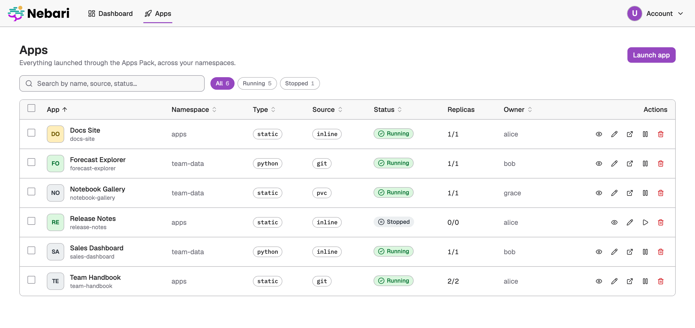

# Nebari Apps Pack

A [Nebari](https://nebari.dev) Software Pack for launching and managing web apps on a Nebari
Kubernetes cluster, behind Keycloak SSO. It runs **static sites** (served by nginx) and
**Python apps** started by a [pixi](https://pixi.sh) task, with no Dockerfile or image build.
It is for platform teams who want their users to publish apps without learning Kubernetes.
The web UI, the REST API, the MCP server for coding agents, and `kubectl`/GitOps all write
the same `App` custom resource, and one operator turns it into workloads, routing and SSO.



> **Status: alpha** ([`pack-metadata.yaml`](pack-metadata.yaml)). APIs, chart values and the
> `App` CRD may still change between releases.

## How it works

Every producer writes an `App` (`apps.nebari.dev/v1alpha1`). The **apps-operator** reconciles
it into a Deployment, a Service and a `NebariApp`; the
[nebari-operator](https://github.com/nebari-dev/nebari-operator) turns the `NebariApp` into an
HTTPRoute, a TLS certificate, Keycloak SSO and, optionally, a landing-page tile. Each app is
served at `https://<subdomain>.apps.<cluster-domain>`. The apps-api is the single authority:
the UI and the MCP server are thin clients over it, so a launch behaves the same from a form
or from an agent. See [Architecture & auth](https://packs.nebari.dev/apps-pack/architecture/).

## Components

| Component | What it does | Image |
|---|---|---|
| apps-operator | Reconciles `App` resources into a Deployment, Service, ConfigMap and `NebariApp`, and reports status. | `apps-operator` |
| apps-api | REST API for CRUD, status, logs, events, analytics and zip/`.html` upload; writes `App` resources for the UI and the MCP server. | `apps-api` |
| apps-ui | Dashboard with a Needs attention card, the apps list, app detail with logs and events, and the launch form. | `apps-ui` |
| apps-mcp | MCP server at `/mcp` that lets coding agents launch and manage apps, with Keycloak device-flow login. | `apps-mcp` |
| apps-authz | Sidecar in the pods of Apps that list `access.groups` or `access.users`; returns `403` to everyone else. | `apps-authz` |

Images are published to `ghcr.io/nebari-dev/apps-pack/<image>` and
`quay.io/nebari/apps-pack-<image>`. The UI signs in with keycloak-js and the API validates its
JWTs, while launched apps contain no auth code and are protected at the gateway
([authentication](https://packs.nebari.dev/apps-pack/architecture/#authentication)). The UI can
be rebranded from chart values without rebuilding the image
([branding](https://packs.nebari.dev/apps-pack/branding/)). The repository map is in
[AGENTS.md](AGENTS.md#repository-map), and the `new-nebari-app` skill in
[`skill/`](skill/new-nebari-app/) scaffolds apps for coding agents.

## Quick start

Prerequisites: a Nebari cluster running nebari-operator `v0.1.0-alpha.20` or later (the version
pinned in [`.nebari-operator-version`](.nebari-operator-version)), Helm 3.8+, and `kubectl` with
cluster-admin. The full list is in
[Getting started](https://packs.nebari.dev/apps-pack/getting-started/).

```bash
# Namespaces must opt in to the nebari-operator; apps launch into `apps` by default.
kubectl create namespace apps && kubectl label namespace apps nebari.dev/managed=true
helm install nebari-apps oci://ghcr.io/nebari-dev/apps-pack/charts/nebari-apps \
  --namespace nebari-apps --create-namespace \
  --set clusterDomain=<your-cluster-domain> \
  --set keycloak.url=https://keycloak.<your-cluster-domain>/auth
kubectl label namespace nebari-apps nebari.dev/managed=true
```

Then open `https://apps.<your-cluster-domain>` and sign in. To launch an app without the UI,
apply an `App`:

```yaml
apiVersion: apps.nebari.dev/v1alpha1
kind: App
metadata:
  name: team-site
  namespace: apps
spec:
  displayName: Team Site
  source:
    type: git
    git: { url: "https://github.com/org/site", ref: main, subdir: public }
  access:
    public: false
    groups: [analysts]
    subdomain: team-site
```

Once `kubectl get apps -n apps` shows `Running`, the site is at
`https://team-site.apps.<your-cluster-domain>`, open to members of `analysts`. Uploads, Python
apps, the REST API and the agent flow are covered in
[Launching apps](https://packs.nebari.dev/apps-pack/launching-apps/).

## Documentation

The user guide is at [packs.nebari.dev/apps-pack](https://packs.nebari.dev/apps-pack/):

- [Getting started](https://packs.nebari.dev/apps-pack/getting-started/): prerequisites, install options (Argo CD included) and known limitations
- [Launching apps](https://packs.nebari.dev/apps-pack/launching-apps/): UI, upload, API and `kubectl`
- [MCP server](https://packs.nebari.dev/apps-pack/mcp/) and the [scaffolding skill](https://packs.nebari.dev/apps-pack/skill/)
- [Configuration](https://packs.nebari.dev/apps-pack/configuration/): every chart value
- [App CRD reference](https://packs.nebari.dev/apps-pack/app-crd-reference/) and [REST API](https://packs.nebari.dev/apps-pack/api-reference/)
- [Runbook](https://packs.nebari.dev/apps-pack/runbook/), [troubleshooting](https://packs.nebari.dev/apps-pack/troubleshooting/) and [upgrading](https://packs.nebari.dev/apps-pack/upgrading/)
- [CI/CD & releasing](https://packs.nebari.dev/apps-pack/ci-cd/)
- [Local development](https://packs.nebari.dev/apps-pack/local-development/): the full stack on kind

## Known limitations

- `access.groups` and `access.users` are enforced in the app pod by the apps-authz sidecar, not
  at the gateway; group changes apply when the user's token refreshes (5 minutes by default).
- Landing-page tile visibility is group-based only, so the launch form's landing-page switch is
  locked for now; register a tile through the API, the MCP server or `kubectl`.
- Users see and manage only the Apps they launched; members of `api.adminGroups` manage all of
  them. There is no sharing yet.
- Inline sources are capped at about 900 KB of text; larger sites need a `git` or `pvc` source.

The full list is in [Getting started](https://packs.nebari.dev/apps-pack/getting-started/#known-limitations).

## Releases

[release-please](https://github.com/googleapis/release-please) keeps a `chore: release X.Y.Z`
pull request open; merging it is the release. The chart is published to
`oci://ghcr.io/nebari-dev/apps-pack/charts` and to the
[org Helm repository](https://github.com/nebari-dev/helm-repository), and the chart and images
are signed with cosign
([verifying Nebari pack artifacts](https://github.com/nebari-dev/.github/blob/main/verifying-nebari-artifacts.md)).
Changes are listed in [CHANGELOG.md](CHANGELOG.md); details are in
[CI/CD & releasing](https://packs.nebari.dev/apps-pack/ci-cd/).

## Contributing

See [CONTRIBUTING.md](CONTRIBUTING.md) for the development loop and quality gates, and
[AGENTS.md](AGENTS.md) if you work with a coding agent. Participation is governed by the
[Code of Conduct](CODE_OF_CONDUCT.md); report security issues as described in
[SECURITY.md](SECURITY.md).

## License

[Apache License 2.0](LICENSE).
